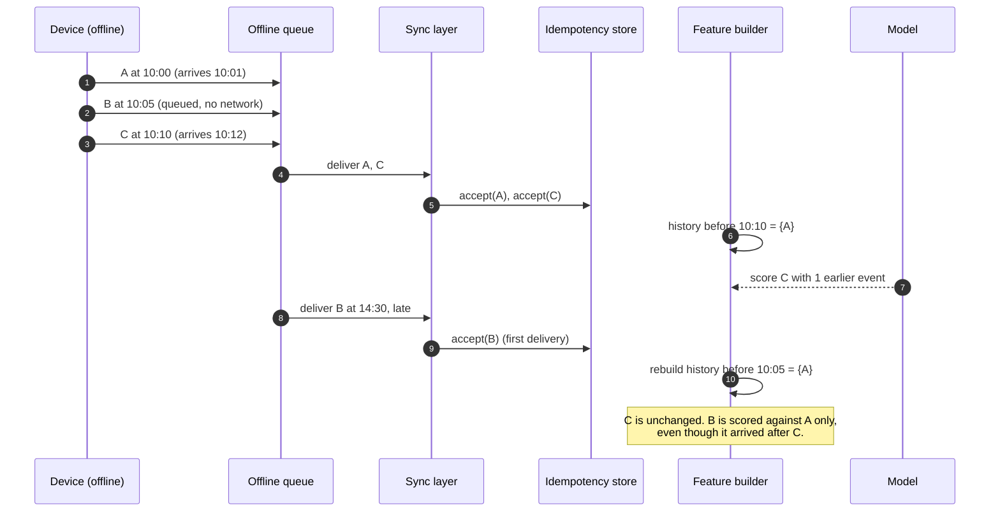

# Architecture: making event-time leakage impossible to ignore

MeshShield is a small system, but it exists to make one hard problem visible: **an offline
payment event is dated by the device that created it, while the system learns about it much
later.** Any feature built from "all the data we have" will therefore answer a different question
than the one a reviewer asks at decision time.

This document explains the problem, the rule the codebase follows, a worked example, and the test
that keeps the rule true.

## The two clocks

Every `Transaction` carries two timestamps:

| Field | Meaning | Who sets it |
| --- | --- | --- |
| `event_time` | When the device believes the payment happened. | The device clock. Skewed and drifting. |
| `ingestion_time` | When the sync layer accepted the event. | The server clock. Monotonic in our model. |

`ingestion_time >= event_time` is enforced at the contract level, but the gap is unbounded up to
the offline window. The generator produces devices with a seeded clock offset and drift, so
`event_time` is *approximately* right, never exactly right.

The important consequence: **sorting by `ingestion_time` gives you the order the fraud team
learned about events; sorting by `event_time` gives you the order the payments happened.** A model
trained on the first and evaluated on the second looks excellent and is useless. A model trained
on the second cannot be computed in real time unless the features are constrained to the past.

## The rule

> A feature for transaction *t* may only use events whose `event_time` is **strictly earlier**
> than `t.event_time`. Events with an equal timestamp are invisible to each other. Arrival order
> is irrelevant. Later arrivals can never change an earlier row.

Three properties follow, and each one is a test:

1. **Causality** — features depend only on the past.
2. **Order invariance** — shuffling the input file does not change any feature row.
3. **Immutability under the future** — appending an event cannot rewrite history.

The implementation lives in `src/meshshield/features/build.py`. It sorts by `(event_time,
transaction_id)`, groups equal timestamps, computes every row in a group *before* appending any
member of that group to history, then advances the histories. That single ordering decision is
what makes equal-timestamp rows symmetric instead of dependent on file order.

## Worked example

Three events from one account and one device:

| Event | `event_time` | `ingestion_time` | Amount |
| --- | --- | --- | --- |
| A | 10:00 | 10:01 | 40 |
| B | 10:05 | 14:30 | 60 |
| C | 10:10 | 10:12 | 900 |

Note that B is *late*: it happened before C but arrived long after it. A naive implementation
processing ingestion order sees A, C, B and computes `account_velocity_1h` for C as 1 — it has
seen A, but not B, which was in the same hour.

MeshShield sorts by `event_time` first, so it computes:

| Transaction | `account_velocity_1h` | Why |
| --- | --- | --- |
| A | 0 | nothing earlier |
| B | 1 | A at 10:00 |
| C | 2 | A and B, both earlier |

C's row is identical no matter which order the file stores the three events in. If the late B had
arrived after training started, it still would not change C — but it *does* become visible to any
event after 10:05 that is scored later.

### Sequence

The late event is flagged (`late_arrival_delta_minutes`), reported in the sync summary, and kept
for review — but it never rewrites C.

## Where leakage usually sneaks in

1. **Global encoder fitting.** Fitting a scaler or target encoder on the whole dataset leaks the
   future into training rows. MeshShield fits the model's means and scales on the training slice
   only, in `LogisticModel.fit`, and reuses them at scoring time.
2. **Global graph construction.** Building one account–device graph and looking up PageRank for a
   past transaction leaks future relationships. `features/build.py` builds graph structure
   incrementally: components, degrees and 2-hop sizes are updated *after* each timestamp group.
   PageRank and community labels are recomputed from the causal snapshot and are only available
   when `networkx` is installed.
3. **Random splits.** A shuffled split puts events from the same account on both sides. Every
   split here is chronological (`split_index` on event-time order), and the earlier period is
   split again 80/20 into fit and calibration.
4. **Calibrating on the holdout.** Platt scaling is fitted on the calibration slice inside the
   training period, never on the holdout.
5. **Integrity as a leak.** Duplicate and replay detection must run in *ingestion* order, because
   that is when a reviewer would know. The pipeline evaluates integrity findings separately from
   the model score so the two do not contaminate each other.

## The test that proves it

`tests/test_features_no_leakage.py` encodes the rule in four ways:

- **Recompute** every row from only strictly-earlier events and assert equality with the pipeline.
- **Shuffle** the input list with Hypothesis and assert the per-transaction feature dictionaries
  are identical.
- **Append** an event with a later `event_time` and assert no earlier row changes.
- **Split** the ordered dataset and assert `max(train.event_time) < min(test.event_time)`.

`tests/test_out_of_order_sync.py` covers the delivery side: shuffled and in-order deliveries must
produce the same accepted-event set and the same final feature table.

If a future change breaks the rule, these tests fail before the README can claim anything.

## What this design does not solve

- Device clocks in this simulator are skewed by a seeded model, not measured. Real skew is
  correlated within a manufacturer and changes after battery events.
- Event-time ordering cannot recover events that were never signed or never arrived.
- Equal timestamps are treated as simultaneous. In production you would need a deterministic
  breaker (device sequence number) rather than lexicographic IDs.
- `event_time` is still attacker-influenced: a malicious device can backdate. The replay window
  and per-device counter reduce the window but do not eliminate it.
