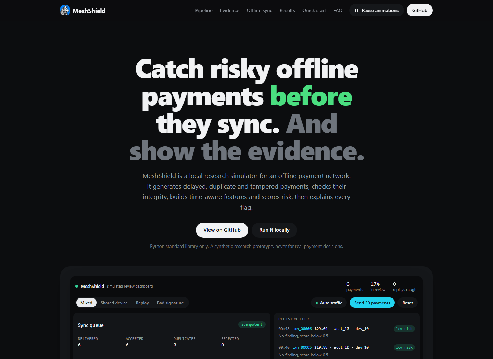
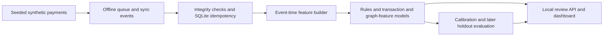

<p align="center"></p>

<h1 align="center">MeshShield</h1>

**Offline payment risk simulator. Integrity checks, time-aware features, explainable scores.**

  

[Open the MeshShield landing page](https://nihalmachhi.github.io/MeshShield/)



MeshShield is a local research project for exploring how an offline payment system can identify transactions that deserve human review. It creates synthetic payment and sync events, detects integrity problems such as duplicate delivery, builds features from earlier events only, and compares model scores with simple rules. It does not process or authorize payments.

> **Synthetic research prototype. Not for real payment decisions.** Generated labels are scenarios written into the simulator, not verified fraud.

## Quick start

Requires Python 3.11 or newer. Runtime code uses the Python standard library; install the project locally to add the `meshshield` command.

### Windows PowerShell

```powershell
py -3 -m venv .venv
.\.venv\Scripts\Activate.ps1
python -m pip install -e .
meshshield demo
meshshield serve
```

### macOS or Linux

```sh
python3 -m venv .venv
source .venv/bin/activate
python -m pip install -e .
meshshield demo
meshshield serve
```

Open [http://127.0.0.1:8000](http://127.0.0.1:8000). Stop the server with Ctrl+C. The demo writes synthetic transactions, evaluation metrics, and local SQLite state under `data/generated/`; these generated files are ignored by Git.

To run without installing the console command, use `python -m meshshield.cli demo` and `python -m meshshield.cli serve` from the repository root.

## How it works



Events can arrive late, out of order, or more than once. The sync layer applies each event ID once and checks its signature. Features use transactions that happened earlier in event time, while ingestion time records when a sync arrived. The evaluation keeps a later event-time holdout separate from model fitting and calibration.

## Landing page

The design reference is published with GitHub Pages at [nihalmachhi.github.io/MeshShield](https://nihalmachhi.github.io/MeshShield/). The page is a self-contained static HTML file with an interactive, illustrative payment simulator; it does not call the Python API.

- Preview locally: `python -m http.server -d site 8080`, then open `http://127.0.0.1:8080`.
- Refresh the result cards after running `meshshield demo`: `python scripts/update_site_metrics.py`. The updater reads `data/generated/metrics.json` and replaces only the block between its metrics markers.
- GitHub Pages deploys the `site/` directory from `main` using the Pages workflow. If first deployment does not start, choose **GitHub Actions** as the Pages build and deployment source in repository settings.

## Project structure

```text
MeshShield/
├── .github/workflows/       # CI and GitHub Pages deployment
├── .editorconfig
├── .gitignore
├── data/generated/          # Local generated run data; only .gitkeep is tracked
├── docs/                    # Architecture, evaluation, threat model, guide, and assets
│   └── assets/              # README icon and landing-page screenshot
├── frontend/                # Static review dashboard served by the Python API
├── scripts/                 # Local runner, benchmark, dataset and site helpers
├── site/                    # Self-contained public landing page
├── src/meshshield/          # API, core, data, features, models, evaluation
├── tests/                   # Unit and API integration tests
├── Dockerfile
├── docker-compose.yml
├── LICENSE
├── Makefile
├── README.md
└── pyproject.toml
```

Repository-specific agent guidance is preserved in [docs/SKILL.md](docs/SKILL.md).

## Commands

| Command | Purpose |
| --- | --- |
| `meshshield demo` | Generate a reproducible sample, fit/evaluate models, and exercise offline sync. |
| `meshshield serve --port 8000` | Start the local review UI and API. |
| `meshshield generate --count 1600 --seed 2025` | Generate synthetic records and a data card. |
| `meshshield train` / `meshshield evaluate` | Fit, calibrate, and print saved holdout results. |
| `python scripts/benchmark.py --count 1600 --seed 2025` | Measure one local synthetic generate-and-train run. |
| `python scripts/update_site_metrics.py` | Update landing-page result cards from the latest saved metrics. |
| `python scripts/build_guide.py` | Build the project walkthrough PDF under `docs/`. |

Install development tools with `python -m pip install -e ".[dev]"`. Then run `python -m ruff check src tests scripts`, `python -m ruff format --check src tests scripts`, `python -m mypy src/meshshield`, and `python -m pytest -q`.

## Limitations

- All built-in data and labels are synthetic. Strong scores only show how well a method recovers patterns in this generator.
- The graph-feature baseline is logistic regression with relationship features, not a graph neural network.
- Cost weights and review capacity are illustrative configuration choices, not operational recommendations.
- The browser simulator is illustrative and runs independently of the Python backend.
- Optional model backends and external datasets require separate dependencies, access, and terms review.
- The local API has no authentication and is intended to bind to localhost for demonstration.

## Documentation

- [Architecture](docs/ARCHITECTURE.md)
- [How the project works](docs/how-it-works.md)
- [System model](docs/system-model.md)
- [Feature contract](docs/feature-contract.md)
- [Evaluation protocol and measured synthetic run](docs/evaluation.md)
- [Synthetic-data limits](docs/synthetic-data.md)
- [Public dataset adapters and terms](docs/public-datasets.md)
- [Threat model](docs/THREAT_MODEL.md)
- [Project walkthrough PDF](docs/MeshShield_How_It_Works.pdf)

## License

Source code is MIT licensed. External datasets retain their own terms and are not included.
