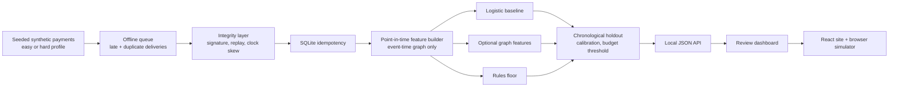

<p align="center"></p>

<h1 align="center">MeshShield</h1>

**An offline payment risk research simulator that checks event integrity, builds point-in-time
signals, and explains synthetic risk scores for human review.**


[Open the live site](https://nihalmachhi.github.io/MeshShield/) ·
[Architecture](ARCHITECTURE.md) ·
[Docs](docs/) ·
[Walkthrough PDF](output/pdf/meshshield-walkthrough.pdf)

> **Synthetic data only.** Labels encode scenarios produced by the generator. They are not
> verified fraud, and the numbers below do not demonstrate real-world detection performance.

<!--
TODO(screenshot): run `python scripts/capture_screenshots.py` (needs Playwright) after
`npm run build --prefix site`, then replace this comment with:

<p align="center"></p>
<p align="center"></p>
-->

## Why this exists

Offline payment devices keep working when the network does not. That creates three problems
that a toy fraud model usually ignores: events arrive **late and out of order**, events arrive
**twice**, and features computed from "all data" quietly **leak the future** into the past.
MeshShield is a small, deterministic lab for getting those three things right, with numbers you
can reproduce on your own laptop in a few seconds.

It is deliberately narrow: synthetic payments, a local SQLite idempotency store, point-in-time
features, a transparent logistic baseline, optional graph/tree comparators, and a chronological
holdout. It never authorizes, moves, or reconciles money.

## Quick start

Requires Python 3.11+ and Node.js 20+ (Node is only needed for the site).

```powershell
# Windows PowerShell
py -3 -m venv .venv
.\.venv\Scripts\Activate.ps1
python -m pip install -e ".[dev]"
meshshield demo
meshshield serve          # http://127.0.0.1:8000
```

```bash
# macOS / Linux
python3 -m venv .venv
source .venv/bin/activate
python -m pip install -e ".[dev]"
meshshield demo
meshshield serve
```

The core commands (`generate`, `train`, `evaluate`, `demo`, `serve`) need **only the standard
library**. Everything else is an optional extra:

| Extra | Installs | Unlocks |
| --- | --- | --- |
| `dev` | pytest, hypothesis, ruff, mypy | tests, linting, type checks |
| `crypto` | cryptography | real Ed25519 signatures and key rotation |
| `graph` | networkx | PageRank and community reports for the dashboard |
| `boost` | lightgbm, scikit-learn | LightGBM comparator |
| `docs` | reportlab | the walkthrough PDF |
| `data` | kaggle | public dataset download helper |

Missing an extra never breaks an import: the feature degrades and says why.

## Measured results

One local run, seed `2025`, 1,600 synthetic transactions, event-time 80/20 holdout
(320 rows, 56 positive). Generated by `meshshield demo` and copied from
`data/generated/metrics.json`.

| Model | PR-AUC | ROC-AUC | Precision | Recall | Brier |
| --- | --- | --- | --- | --- | --- |
| Rules only (floor) | **0.709** | 0.905 | 0.647 | 0.440 | 0.079 |
| Transaction-only logistic | 0.545 | 0.920 | 0.537 | 0.880 | 0.108 |
| Graph-feature logistic | 0.678 | 0.943 | 0.686 | 0.700 | 0.070 |
| Full pipeline (integrity + calibrated graph) | **0.859** | **0.968** | 0.882 | 0.600 | **0.055** |

Precision/recall use the calibrated, review-capacity-constrained threshold for the model rows and
0.5 for the uncalibrated baselines. **Reading these honestly:** on this easy profile the graph
features beat the transaction-only model on PR-AUC (0.678 vs 0.545; paired 95% interval for the
difference +0.064 to +0.216). They do **not** beat fixed rules on PR-AUC (0.678 vs 0.709), and on
the hard profile the gain disappears (0.914 vs 0.911). The pipeline number is higher mostly because
integrity checks short-circuit invalid signatures, not because the model is better. Treat all rows
as evidence that the plumbing works, not as a ranking of methods. Full tables and intervals are in
[docs/evaluation.md](docs/evaluation.md).

Reproduce with:

```bash
meshshield demo
python scripts/export_site_data.py     # writes site/src/data/results.js
```

## How it works



The browser simulator on the site is illustrative and runs entirely in your browser with a fixed
seed. The local API serves saved evaluation results and transaction evidence from `data/generated/`.

## Repository layout

```text
MeshShield/
├── .github/workflows/     # ci.yml (Python + site + docker) and site.yml (Pages)
├── data/generated/        # ignored demo output: JSONL, models, metrics, SQLite
├── docs/                  # system model, contracts, threat model, evaluation, changes
├── scripts/               # dataset, benchmark, export, screenshot and PDF helpers
├── site/                  # React + Vite site, browser simulator and unit tests
├── src/meshshield/        # contracts, generator, integrity, features, models, eval, api
├── tests/                 # leakage, idempotency, ordering, split, integrity, CLI
├── ARCHITECTURE.md        # the event-time leakage problem, worked end to end
├── CONTRIBUTING.md
├── SECURITY.md
├── Dockerfile
└── pyproject.toml
```

## Commands

| Command | Purpose |
| --- | --- |
| `meshshield demo` | Generate, train, evaluate and replay sync deliveries. |
| `meshshield serve` | Serve the built React site and the local JSON API. |
| `meshshield generate --profile hard --seed 2025` | Generate the adversarial synthetic profile. |
| `meshshield train --model logistic` | Fit and save a named model. |
| `meshshield evaluate` | Print the saved chronological holdout metrics. |
| `python scripts/eval_public.py --dataset paysim --input <file>` | Evaluate on a local public dataset, if you have one. |
| `python scripts/benchmark.py` | Time one local run and write a JSON report. |
| `npm --prefix site run dev` | React development server. |
| `npm --prefix site test` | Unit tests for the browser simulation logic. |

Development checks: `python -m ruff check src tests scripts`,
`python -m ruff format --check src tests scripts`, `python -m mypy src/meshshield`,
`python -m pytest -q --cov=meshshield`.

## API

All endpoints bind to `127.0.0.1` only and carry no authentication.

| Endpoint | Returns |
| --- | --- |
| `GET /api/health` | Liveness, version and dataset availability. |
| `GET /api/metrics` | Saved evaluation results. |
| `GET /api/calibration` | Reliability curve, ECE and threshold policy. |
| `GET /api/drift` | PSI per feature plus rolling average precision. |
| `GET /api/ablation` | Feature-group ablation from the last training run. |
| `GET /api/transactions?limit=20` | Sample transactions with evidence. |
| `POST /api/score` | Score one transaction against the saved model. |

## Limits

- Records and labels are synthetic. The generator's scenarios are not real fraud, and the
  measured numbers above cannot be transferred to production.
- The graph features are incremental degrees, two-hop reach and union-find component sizes over an
  account–device graph. This is **not** a graph neural network. PageRank and community labels are
  snapshot reports for the dashboard, not training features. `models/graph_sage.py` is an optional
  experiment and is not part of the reported results.
- Thresholds, review capacity and cost weights are explicit demo assumptions.
- The replay window and key registry are implemented, but the demo still ships a simulated signer
  by default; Ed25519 requires the `crypto` extra.
- The local API has no authentication and is for localhost demonstrations only.
- Public-dataset results are not included. `scripts/eval_public.py` runs only if you supply a file;
  no numbers are hard-coded anywhere.

## Documentation

| Document | Contents |
| --- | --- |
| [ARCHITECTURE.md](ARCHITECTURE.md) | Event-time leakage, worked example, the test that proves it. |
| [docs/system-model.md](docs/system-model.md) | Components, data flow and trust boundaries. |
| [docs/feature-contract.md](docs/feature-contract.md) | Every feature, its window and why it cannot leak. |
| [docs/evaluation.md](docs/evaluation.md) | Split, metrics, calibration, budget thresholds, bootstrap. |
| [docs/synthetic-data.md](docs/synthetic-data.md) | Profiles, parameters and blind spots. |
| [docs/threat-model.md](docs/threat-model.md) | Threats, controls and the tests that prove them. |
| [docs/ablation.md](docs/ablation.md) | Feature-group ablation from the last run. |
| [docs/CHANGES.md](docs/CHANGES.md) | What changed against the five original weaknesses. |

## License

Source code is MIT licensed. External datasets are not included and keep their own terms.
