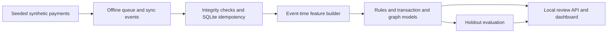

<p align="center">
  
</p>

<h1 align="center">MeshShield</h1>

MeshShield is a local, synthetic research simulator for risk review in an offline payment network. It generates payment and sync events, checks event integrity, calculates time-aware transaction and relationship features, compares a logistic-regression baseline to a graph-feature model and simple rules, and serves a small browser dashboard.

> **Synthetic research prototype.** It does not authorize, settle, or move money. Its labels are generated scenarios rather than verified fraud. Do not use its scores to make real payment or account decisions.

## How it works

A payment is scored using only information available at its event time. Offline delivery integrity is evaluated separately so a suspicious signature or duplicate sync cannot be hidden inside a model score.



The generator creates reproducible synthetic transactions. The sync simulator delivers events late, out of order, or more than once; storage accepts each event ID once. Features are computed in event-time order without using future labels. The dashboard presents scores and evidence alongside holdout metrics. Scores are research signals from synthetic data, not real fraud probabilities.

## Run locally

Requires Python 3.11 or newer. The application uses only the Python standard library and has no external runtime dependencies.

```powershell
py -3 -m venv .venv
.\.venv\Scripts\Activate.ps1
.\scripts\run.ps1 demo
.\scripts\run.ps1 serve
```

Open [http://127.0.0.1:8000](http://127.0.0.1:8000). On macOS/Linux, use `python3 -m venv .venv`, activate it with `source .venv/bin/activate`, then run `PYTHONPATH=src python -m meshshield.cli demo` and `PYTHONPATH=src python -m meshshield.cli serve`.

The PowerShell runner sets the local source path and starts the Python CLI without installing packages. The project root is also the working directory for generated artifacts.

With Docker Desktop, `docker compose up --build` runs the local dashboard at [http://127.0.0.1:8000](http://127.0.0.1:8000). The container publishes only to localhost and keeps generated state in a Docker volume. Stop it with `docker compose down`.

## Commands

| Command | Purpose |
| --- | --- |
| `.\scripts\run.ps1 generate --count 1600 --seed 2025` | Write a deterministic synthetic dataset and dataset card. |
| `.\scripts\run.ps1 train` | Fit on the first 64% of event time, calibrate on the next 16%, and report the final 20% holdout. |
| `.\scripts\run.ps1 evaluate` | Print the saved holdout metrics. |
| `.\scripts\run.ps1 demo` | Regenerate the default data, train both models, evaluate, and simulate delayed/duplicate delivery. |
| `.\scripts\run.ps1 serve --port 8000` | Start the local review UI and JSON API. |
| `python scripts/benchmark.py --count 1600 --seed 2025` | Measure one synthetic generate/train run and save a local JSON report under `output/benchmarks/`. |

Generated files are under `data/generated/`: JSON Lines transactions and sync events, a dataset card, model parameters, holdout metrics, and a SQLite idempotency table. These reproducible outputs are ignored by Git so the source repository stays small. The default seed is `2025`.

## Follow one transaction

1. The generator assigns synthetic accounts, devices, merchants, amounts, event timestamps, arrival timestamps, and scenario labels.
2. Transactions can be queued while offline. `event_time` records when the payment was created; `ingestion_time` records when its sync was received.
3. Sync delivery can arrive late, out of sequence, or more than once. SQLite accepts each event ID once. Invalid simulated signatures are rejected.
4. The feature builder walks transactions in event-time order. For each transaction it calculates account and merchant velocity, device reuse, delayed-sync duration, time-of-day, and past transaction counts before adding the current event to history.
5. A standardized logistic regression estimates a synthetic risk score. Model contribution values show which inputs push the score up or down. Integrity findings are kept separate and can independently route a transaction to review.
6. The earliest 80% event-time block is split into model fitting and calibration; the latest 20% is the final holdout. The dashboard compares graph features, transaction-only features, and simple rules with precision, recall, F1, average precision, Brier score, and confusion counts.

See [docs/system-model.md](docs/system-model.md) for component boundaries, [docs/feature-contract.md](docs/feature-contract.md) for time and feature semantics, and [docs/how-it-works.md](docs/how-it-works.md) for the guided project walkthrough.

Optional public-data adapters and download terms are documented in [docs/public-datasets.md](docs/public-datasets.md). The default app continues to use only the built-in synthetic data; external datasets are not downloaded or included automatically.

## Local API

| Route | Description |
| --- | --- |
| `GET /api/health` | Local service status and synthetic-data notice. |
| `GET /api/metrics` | Holdout model comparison and delivery simulation summary. |
| `GET /api/transactions?limit=100` | Transaction review rows with score and evidence. |
| `GET /api/transactions/{transaction_id}` | Score one known synthetic transaction. |
| `POST /api/replay` | Apply the same sync event twice to demonstrate idempotency. |

The server binds to `127.0.0.1` by default. Keep it local; it has no authentication and is not designed as a network-facing service.

## Design notes

- **Small components:** see [the architecture guide](docs/ARCHITECTURE.md) for package boundaries and the runtime flow under `src/meshshield/`.
- **Reproducibility:** fixed seeds and a dataset card record data origin and scenario limitations.
- **Causal order:** event time and ingestion time stay distinct. Features use earlier event-time history; labels and later investigation outcomes never enter the feature vector.
- **Auditable evidence:** hard integrity findings are distinct from model associations. Contributions are not causal explanations.
- **Minimal infrastructure:** JSONL supports inspectable datasets; SQLite demonstrates durable idempotency without requiring PostgreSQL, Redis, queues, or cloud accounts.

## Limitations and next steps

This generator is deliberately simple. Scenario patterns are visible to the data creator, generated accounts are not real people, and the synthetic distribution cannot establish real-world performance. The demo now calibrates on a separate synthetic time interval and selects a threshold under illustrative costs and review capacity; none of those assumptions are operational recommendations. Calibration on synthetic labels does not establish calibration on real transactions. Before any research with real data, obtain authorization, minimize sensitive fields, define ground truth with domain experts, assess subgroup impacts, monitor temporal drift, and perform independent validation. Production payment use would need a separate security, privacy, reliability, legal, and model-risk review.

See [docs/evaluation.md](docs/evaluation.md), [docs/synthetic-data.md](docs/synthetic-data.md), and [docs/THREAT_MODEL.md](docs/THREAT_MODEL.md) before extending the simulator.

## License

The MeshShield source code is MIT licensed. External datasets retain their own terms; see [the dataset guide](docs/public-datasets.md). No external dataset is included in this repository.

## Engineering update

The current engineering pass fixes request handling and event integrity, uses point-in-time features, and separates raw model, calibrated model, and integrity-aware pipeline results. The default baseline remains dependency-free; optional GraphSAGE, XGBoost, Isolation Forest, Ed25519, and dataset adapters are opt-in. The report includes a chronological calibration interval, explicit illustrative review capacity/cost inputs, and PSI drift diagnostics. See the measured synthetic-only run and its limits in [the evaluation report](docs/evaluation.md). The source is split by responsibility; Ruff and mypy pass. Passing tests exercise deterministic simulator behavior and optional dependency failure paths; they do not establish fraud detection performance.


