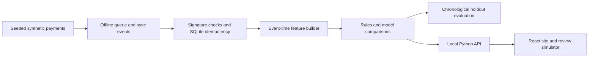

<p align="center"></p>

<h1 align="center">MeshShield</h1>

**An offline payment risk research simulator that checks event integrity, builds time-aware signals, and explains synthetic risk scores for human review.**

   

[Open the MeshShield site](https://nihalmachhi.github.io/MeshShield/)

MeshShield is a local research prototype. It generates synthetic offline payments and sync events, rejects invalid signatures, ignores duplicate deliveries, creates features using earlier event-time history, and compares risk models with transparent rules. It does not authorize payments.

> **Synthetic data only.** Generated labels encode scenarios from the simulator; they are not verified fraud and do not demonstrate real-world performance.

## Quick start

Requires Python 3.11+ and Node.js 22+.

```powershell
# Windows PowerShell
py -3 -m venv .venv
.\.venv\Scripts\Activate.ps1
python -m pip install -e .
npm ci --prefix site
npm run build --prefix site
meshshield demo
meshshield serve
```

For macOS or Linux, replace the virtual environment commands with `python3 -m venv .venv` and `source .venv/bin/activate`. Open [http://127.0.0.1:8000](http://127.0.0.1:8000); stop the server with Ctrl+C.

The React app lives in `site/`. `npm run dev --prefix site` starts the front-end development server; the published build is generated in `site/dist/`. The local Python API serves that build at `/` and its JSON endpoints under `/api/`. GitHub Pages builds and publishes the same React app.

## How it works



The simulator on the landing page is illustrative and runs in the browser. The local API separately serves saved synthetic evaluation results and transaction evidence. Delivery time and event time are stored independently; late and duplicate events are handled by the sync layer. The evaluation reserves later events for holdout rather than shuffling time.

## Repository layout

```text
MeshShield/
├── .github/workflows/   # Python checks, Docker build, React build and Pages deploy
├── data/generated/      # Ignored local demo data; only .gitkeep is tracked
├── scripts/             # Dataset, benchmark and local helper scripts
├── site/                # React + Vite public site and simulator
├── src/meshshield/      # Python API, domain, storage, models and evaluation
├── tests/               # Unit and API integration tests
├── Dockerfile
├── docker-compose.yml
├── Makefile
├── README.md
└── pyproject.toml
```

## Commands

| Command | Purpose |
| --- | --- |
| `meshshield demo` | Generate a reproducible synthetic run and evaluate models. |
| `meshshield serve` | Start the API and serve the built React site. |
| `meshshield generate --count 1600 --seed 2025` | Generate synthetic transactions and a data card. |
| `meshshield train` / `meshshield evaluate` | Fit, calibrate, and report holdout results. |
| `npm run dev --prefix site` | Start the React development server. |
| `npm run build --prefix site` | Build static site files into `site/dist/`. |
| `python scripts/benchmark.py --count 1600 --seed 2025` | Measure one local synthetic run. |

Install Python development tools with `python -m pip install -e ".[dev]"`. Run `python -m ruff check src tests scripts`, `python -m ruff format --check src tests scripts`, `python -m mypy src/meshshield`, and `python -m pytest -q`.

## Limits

- Built-in records and labels are synthetic; generated scenarios cannot validate fraud detection on real payments.
- The graph-feature model uses relationship counts and velocity features; it is not a graph neural network.
- Thresholds and review costs are illustrative. Production use needs a real cost model, review-capacity plan, calibration, drift monitoring, and approved data.
- Optional model backends and external datasets have separate dependencies, access rules, and licensing terms.
- The local API has no authentication and is intended for localhost demonstrations.

## License

Source code is MIT licensed. External datasets are not included and retain their own terms.
