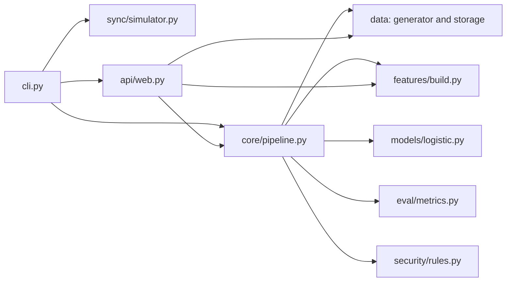

# Architecture

MeshShield is a local research simulator with a small, dependency-free Python runtime. The modules are grouped by responsibility so that payment data contracts, scoring, and sync behavior can be understood and changed independently.

## Package boundaries

| Package | Responsibility |
| --- | --- |
| `core` | Immutable transaction and sync-event contracts, timestamp normalization, and the train/evaluate orchestration. |
| `data` | Deterministic synthetic generation, JSON Lines I/O, and SQLite idempotency storage. |
| `features` | Event-time-ordered point-in-time feature rows. Equal event timestamps are handled as one group, so peer events do not become each other's history. |
| `models` | Dependency-free logistic-regression baseline and its serialized coefficients. |
| `eval` | Binary classification metrics, Platt calibration, capacity/cost threshold selection, and PSI drift diagnostics. |
| `security` | Deterministic simulated-integrity checks and optional Ed25519 payload signing, separate from model probabilities. |
| `sync` | Delay, duplicate, reorder, acceptance simulation, and grow-only event-set merge with same-ID conflict quarantine. |
| `federated` | Sample-weighted FedAvg arithmetic for controlled cross-silo experiments. It is not secure aggregation or differential privacy. |
| `api` | Local-only HTTP dashboard/API adapter. It delegates decisions to the core pipeline and storage adapters. |
| `config.py` / `cli.py` | Shared local paths/defaults and command-line entry point. |

The intended dependency direction is from the command-line and HTTP entry points toward core logic and adapters. The model does not read or write data files itself. The frontend is a static page served by the API adapter.

## Runtime data flow

1. `meshshield generate` writes a seeded synthetic transaction stream, sync events, and a dataset card beneath `data/generated/`.
2. `meshshield train` sorts transactions by normalized UTC event time, builds point-in-time features, uses the earliest 80% for fitting, and reports the later 20% separately.
3. Sync integrity is evaluated in ingestion-time order. The model-only result and the integrity-aware review pipeline are reported as separate metrics.
4. `meshshield serve` loads the saved model and data once, precomputes the event-time feature rows once, and exposes a local review API and static dashboard.

All generated data, fitted model files, and SQLite state are local ignored artifacts. No generated datasets or model weights are part of the source repository.

## Optional research dependencies

The default application remains standard-library-only. `graph` adds a PyTorch Geometric GraphSAGE adapter; `boosted` adds XGBoost; `anomaly` adds scikit-learn Isolation Forest; `crypto` enables Ed25519 signing; and `data` adds the Kaggle CLI. Install only the extra needed, for example `pip install -e ".[crypto]"`. The optional neural/tree/anomaly backends have not been benchmarked here because their dependencies and authorized benchmark datasets were not available. The currently measured run uses the dependency-free model and the synthetic generator.

## Validation

The focused unit tests live under `tests/unit/`, with the HTTP adapter exercised under `tests/integration/api/`. Run `python -m pytest`, `python -m ruff check src tests`, and `python -m mypy src/meshshield` from the repository root.
