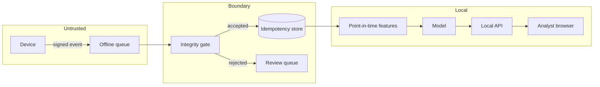

# Threat model

MeshShield is a simulator, so every threat below is modelled against **synthetic**
devices and **fabricated** adversaries. The point is to show which control exists,
what it cannot do, and which test proves it. Nothing here justifies a production
deployment.

## Assets

| Asset | Why it matters |
| --- | --- |
| The event log | Every decision and every feature is derived from it. |
| Device keys | A stolen key lets an attacker sign events as that device. |
| Feature history | If it can be rewritten, evaluation numbers are meaningless. |
| Review decisions | An analyst's queue is the only human control. |

## Threats

| # | Threat | Attacker capability | Control | Test that proves it | Residual risk |
| --- | --- | --- | --- | --- | --- |
| 1 | Forged event | Can create payloads but not signatures | HMAC (simulated) or Ed25519 verification over canonical bytes | `test_a_tampered_amount_is_rejected`, `test_simulated_signer_round_trips_and_detects_a_flip` | A leaked HMAC secret forges anything; the simulated signer is demo-only. |
| 2 | Payload tampering | Can modify a signed event in transit | Signature covers identity, amount, currency, timestamps and counter | `test_a_tampered_amount_is_rejected`, `test_simulated_signer_round_trips_and_detects_a_flip` | A flipped byte and a swapped amount produce the same verifier finding; cryptography cannot tell you *which* byte changed. |
| 3 | Replay of a whole event | Can resend a captured event | SQLite idempotency store plus per-device monotonic counter | `test_the_same_event_is_accepted_exactly_once`, `test_a_replayed_counter_is_rejected` | Idempotency state is local; two unmerged replicas can each accept the same event. |
| 4 | Signature reuse on another event | Can copy a valid signature | Signature ledger maps signature → event ID | `test_signature_reuse_is_detected_across_event_ids` | The ledger is in-memory per process; a restart forgets it unless persisted. |
| 5 | Key theft | Holds a private key | Rotation and revocation windows; arrival-time evaluation | `test_a_revoked_key_is_rejected_after_the_revocation` | Events signed before revocation still verify. That is why they are flagged, not blocked. |
| 6 | Late delivery after revocation | Can delay an already-signed event | Accept and flag `late_after_revocation` | `test_a_signature_made_before_revocation_but_arriving_late_is_flagged_not_blocked` | A patient attacker can use a stolen key indefinitely before the rotation is published. |
| 7 | Device clock manipulation | Can set the device clock | Contract bound plus `event_time_in_future` and per-device drift detection | `test_event_time_in_the_future_is_blocking`, `test_drift_is_flagged_against_the_devices_own_history` | Backdating within the bound is undetectable without a trusted time source. |
| 8 | Device cloning | Two devices share a key and counter | Counter regression plus shared-key visibility in the registry | `test_a_replayed_counter_is_rejected` | The first clone that keeps counters in step looks like the real device. |
| 9 | Fraud-ring collusion | Coordinates accounts, devices and merchants | Graph features (components, degree, 2-hop size) and ring scenarios | `test_component_features_track_the_causal_graph` | Features are associational; benign shared devices look similar. |
| 10 | Model evasion | Structures amounts below the rule, rotates devices | `structuring` and `device_rotation` scenarios; ablation study | `test_hard_profile_is_harder_than_easy` | The generator's evasions are the ones we thought of. |
| 11 | Leakage through features | None — this is an implementation bug | Strictly earlier event time, chronological split, calibration inside train | `test_features_equal_a_strictly_causal_recompute`, `test_a_future_event_cannot_rewrite_history` | New features can reintroduce leakage; the tests only cover today's contract. |
| 12 | Local API abuse | Can reach `127.0.0.1` | Loopback-only bind with a startup warning | `test_server_refuses_a_non_loopback_host` | Any local process can call it; there is no authentication by design. |

## Trust boundaries

- The device is untrusted: it controls `event_time`, the amount and the counter.
- The queue is untrusted: it controls order and duplication, not content.
- The gate is the only place where an event becomes "known".
- The store is trusted for locality only, not for correctness across devices.
- The analyst is trusted to read, not to authorize payments.

## What is deliberately out of scope

- Real payment rails, card networks, UPI/PSP integration, settlement, refunds.
- Real threat intelligence feeds, live network capture, active probing.
- Production identity, key custody (HSM/KMS), or certificate transparency.
- Regulatory requirements (PCI-DSS, PSD2, RBI). This code cannot satisfy them.

## Reporting a vulnerability

See [SECURITY.md](../SECURITY.md). A finding in the simulator is still worth
reporting: the leakage and replay tests are the parts most likely to rot.
